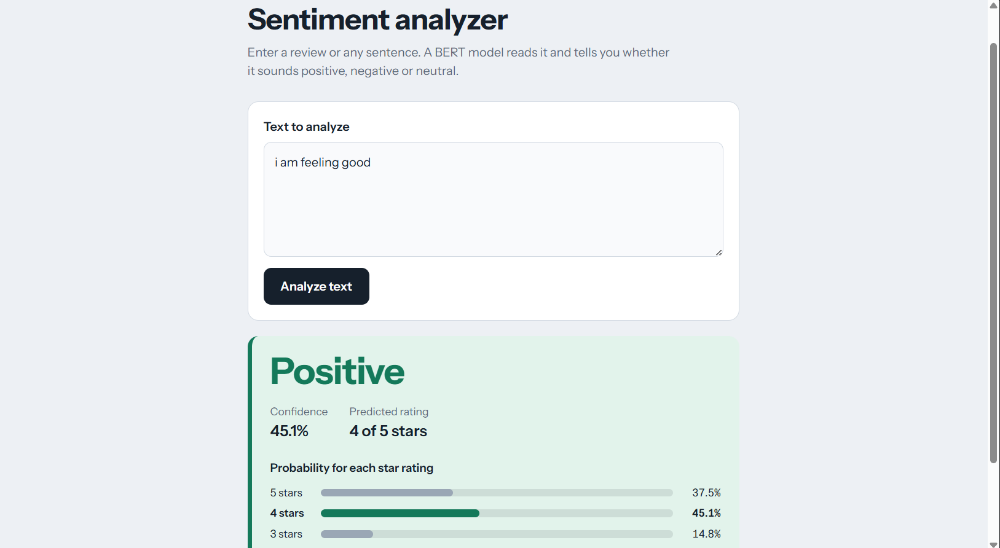

# Sentiment Analyzer using BERT

A web app that reads a piece of text and tells you whether it sounds **Positive, Neutral or Negative**. It uses a pre-trained multilingual BERT model from Hugging Face and also shows the probability for each 1 to 5 star rating.



## Project Structure

```
sentiment-analyzer/
├── app.py               # Flask app and sentiment logic
├── requirements.txt     # Python packages needed
├── README.md            # Project description
├── screenshot.png       # Screenshot of the web app
└── templates/
    └── index.html       # Web page (HTML and CSS)
```

## How It Works

**Objective:** take any sentence or review and classify its sentiment through a simple web page.

**What is used**
- **Flask** runs the web app and connects the page to the Python code.
- **Transformers (Hugging Face)** downloads and runs the model and tokenizer.
- **PyTorch** is the engine the model runs on.
- **Model:** `nlptown/bert-base-multilingual-uncased-sentiment`, a BERT model fine-tuned on product reviews with 1 to 5 star ratings. The model is pre-trained and was not trained in this project.

**Flow**
1. The user types text on the web page and submits it.
2. Flask receives the text and checks that it is not empty.
3. The tokenizer converts the text into token IDs.
4. The BERT model outputs 5 scores, one for each star rating.
5. Softmax converts the scores into 5 probabilities.
6. The star rating with the highest probability is chosen.
7. The stars are mapped to a label: 1 to 2 stars is Negative, 3 stars is Neutral, 4 to 5 stars is Positive.
8. The page shows the label, confidence, predicted rating and a bar for each star probability.

**What is achieved**
- Works on multiple languages, not only English.
- Gives a Neutral label as well as Positive and Negative.
- Shows the full probability spread, not just one answer.
- Clean web interface with input validation.

## Limitations

- **Sarcasm is not identified correctly.** For example, "Oh great, another delay. Just what I needed." is predicted as positive.
- **Confidence is for the top star rating,** not for the final label, so it can look low even when the sentiment is clear.
- **Text longer than 512 tokens is cut off,** and the rest is ignored.
- **Trained on product reviews,** so results may be less reliable on news, tweets or formal writing.
- **The first run is slow** because the model is downloaded.
- The app only runs a pre-trained model. It does not train or update it.

## Run Locally

1. Download this repository (**Code → Download ZIP**) and extract it.
2. Open a terminal inside the extracted folder.
3. Install the required packages:
   ```
   pip install -r requirements.txt
   ```
4. Run the app:
   ```
   python app.py
   ```
5. Open the local address shown in the terminal in your browser.
6. Type some text, click **Analyze text**, and see the result.

> The first run needs an internet connection to download the model.
